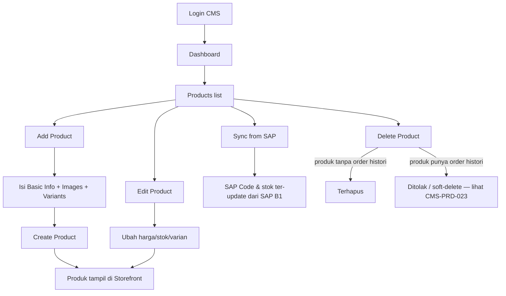
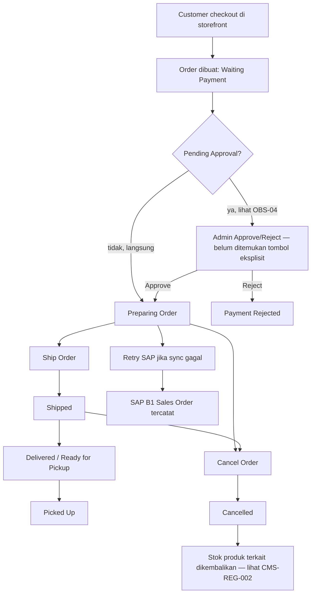
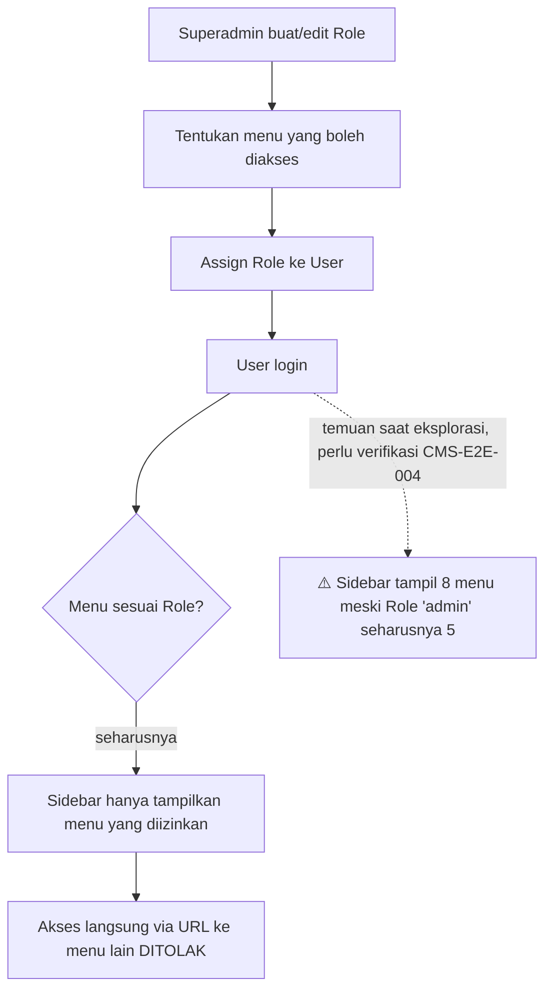

# CMS Admin — Sitemap, Business Flow, Coverage &amp; Automation Recommendation

Dokumen pendamping [11_cms_admin_test_cases.md](11_cms_admin_test_cases.md) —
berisi bagian yang belum ada di sana: Application Sitemap, Business Flow
Diagram, Screen Inventory ringkas, estimasi coverage per modul, dan
rekomendasi otomasi Playwright untuk test case prioritas tinggi.

Tidak mengulang isi 111 test case yang sudah ditulis di file 11 — dokumen ini
hanya menambahkan lapisan ringkasan &amp; navigasi di atasnya.

---

## 1. Application Sitemap

```
MODENA CMS (/cms)
├── /cms/login                    — halaman login (email + password, terpisah dari SSO storefront)
└── /cms (setelah login)
    ├── Dashboard                 /cms
    │   ├── KPI cards (Total Sales, Orders Processed, Orders Waiting Approval, Total Products)
    │   ├── Quick actions (Add Product, Manage Stock, Review Orders)
    │   ├── Order Status funnel (9 status)
    │   ├── Sales Trend chart (Daily/Weekly/Monthly toggle)
    │   ├── Low Stock Alert (Critical/Low/Good)
    │   └── Recent Orders list → Order Detail
    ├── Products                  /cms/products
    │   ├── Search + Pagination
    │   ├── "Sync from SAP"
    │   ├── Add Product           /cms/products/new
    │   │   ├── Basic Information (Name, Category, Price, Badge, Stock, Description)
    │   │   ├── Images (Main Image URL, Upload, per-color images)
    │   │   └── Variants (Colors: Add Color Group/Add Color; Sizes: S/M/L/XL/XXL/One Size + custom)
    │   └── Edit Product          /cms/products/{id}/edit  (form sama dengan Add)
    ├── Orders                     /cms/orders
    │   ├── Status filter chips (9 status)
    │   └── Order Detail          /cms/orders/{id}
    │       ├── Items / Shipping / Payment / Customer
    │       ├── SAP B1 Sales Order panel
    │       └── Actions: Logs, Retry SAP, Ship Order, Cancel Order
    ├── Stock                      /cms/stock
    │   └── Tabel stock per size + Total Stock + Status
    ├── Categories                 /cms/categories
    │   └── CRUD kategori (belum dieksplorasi sampai ke form)
    ├── Users                      /cms/users
    │   └── Manajemen user CMS (belum dieksplorasi sampai ke form)
    ├── Roles                      /cms/roles
    │   ├── admin (5 menu)
    │   ├── customer (0 menu)
    │   ├── superadmin (7 menu, Locked)
    │   └── Add Role
    └── Settings                   /cms/settings
        ├── Xendit Payment Gateway (enable toggle, Secret Key, Callback Token, Webhook URL)
        ├── Email Notifications (BCC recipients)
        └── SAP B1 Sales Order config
```

---

## 2. Business Flow Diagram

### 2a. Product lifecycle



### 2b. Order lifecycle (transaction + approval)



### 2c. Role &amp; permission flow (terkait OBS-01)



---

## 3. Screen Inventory (ringkas)

| # | Screen | Tipe | Modul Terkait di File 11 |
|---|---|---|---|
| 1 | Login | Form | CMS-SMK-001 |
| 2 | Dashboard | Dashboard/Chart | CMS-DSH-001..008 |
| 3 | Products (list) | Table + Search + Pagination | CMS-PRD-001..006 |
| 4 | Add Product | Form (wizard-like: Basic/Images/Variants) | CMS-PRD-007..018 |
| 5 | Edit Product | Form | CMS-PRD-019..021 |
| 6 | Orders (list) | Table + Filter chips | CMS-ORD-001 |
| 7 | Order Detail | Detail + Actions | CMS-ORD-002..012, CMS-APR-001..002 |
| 8 | Stock | Table | (tercakup ringkas — perlu ekspansi lanjutan, lihat §5) |
| 9 | Categories | Table + CRUD | CMS-PRD-024..025 |
| 10 | Users | Table + CRUD | CMS-USR-001..006 |
| 11 | Roles | Table + Edit + Add | CMS-ROL-001..005 |
| 12 | Settings | Form (3 section) | CMS-SET-001..007 |

**Total screen teridentifikasi: 12** (dari target scan menyeluruh — Categories/Users/Stock belum dieksplorasi sampai ke level form/modal detail, lihat §5 "Gap coverage").

---

## 4. Coverage Estimate

Dihitung dari: (jumlah test case tertulis + kedalaman eksplorasi live) dibagi
cakupan realistis modul tsb (bukan hanya jumlah TC, karena TC banyak ≠
tercakup penuh jika sebagian besar masih "Not Run").

| Modul | Test Case Ditulis | Sudah Terverifikasi Live (Pass) | Estimasi Coverage Desain | Estimasi Coverage Eksekusi |
|---|---|---|---|---|
| Dashboard | 8 | 1 | 85% | 12% |
| Products (list+Add+Edit+Delete) | 25 | 0 | 80% | 0% |
| Orders + Approval | 14 | 2 | 70% | 14% |
| Report | 1 | 0 | 20% (modul tidak ditemukan) | 0% |
| CMS Navigation/Layout | 6 | 1 | 75% | 17% |
| Users | 6 | 0 | 50% (form belum dieksplorasi) | 0% |
| Roles | 5 | 2 | 80% | 40% |
| Settings | 7 | 0 | 75% | 0% |
| Notification | 2 | 0 | 40% | 0% |
| Audit Log | 2 | 0 | 30% (modul global tidak ditemukan) | 0% |
| API | 5 | 0 | 40% (endpoint belum di-inspect via Network tab) | 0% |
| Security | 8 | 0 | 55% | 0% |
| Performance | 3 | 0 | 30% (butuh data besar/seed khusus) | 0% |
| Accessibility | 4 | 1 (parsial) | 40% | 6% |
| Regression | 3 | 0 | 60% | 0% |
| Smoke | 4 | 3 | 100% | **75%** |
| Sanity | 2 | 0 | 60% | 0% |
| UAT | 2 | 0 | 50% | 0% |
| E2E | 4 | 0 | 65% | 0% |
| **Total (111 TC)** | **111** | **10** | **~62% (rata-rata desain)** | **~9% (rata-rata eksekusi)** |

**Interpretasi:** cakupan *desain* test case (seberapa lengkap skenario tertulis
relatif terhadap fitur yang ditemukan) sudah cukup baik (~62%), tapi cakupan
*eksekusi* masih rendah (~9%) karena sebagian besar memang sengaja belum
dijalankan untuk menjaga data dev tetap bersih (Delete Product, Cancel Order,
Ship Order, dll.) — konsisten dengan prinsip yang sudah diterapkan di suite
storefront (lihat [automation/README.md](automation/README.md) soal stok
terbatas &amp; order nyata).

---

## 5. Gap Coverage (belum tercakup, perlu sesi eksplorasi lanjutan)

- **Categories, Users, Stock**: baru dipetakan di level list/kolom tabel — form
  Add/Edit/Delete-nya belum dibuka. Screen inventory di §3 masih 12, bukan 15+
  yang sebenarnya ada begitu 3 modul ini dibuka sampai form-nya.
- **Compatibility testing** (Firefox/Safari/Edge/mobile browser) — 0% dieksekusi,
  seluruh eksplorasi ini hanya di Chrome sesuai environment yang diminta.
- **Database testing** langsung (bukan lewat UI) — tidak ada akses DB di sesi
  ini; seluruh temuan integrity berbasis observasi UI/API.
- **API test** belum inspect Network tab secara langsung — endpoint yang
  disebut di file 11 (mis. `/backend/api/webhooks/xendit`) baru dari HTML,
  belum diverifikasi status code/response aktualnya.

---

## 6. Rekomendasi Otomasi Playwright

Skeleton sudah dibuat &amp; **sudah dijalankan langsung terhadap CMS live** di
[cms/automation/](cms/automation/) — bukan sekadar rekomendasi teoretis:

| File | Mencakup TC ID | Status |
|---|---|---|
| `cms/automation/fixtures.js` | `loginCms()`, daftar `CMS_MENUS` | — |
| `cms/automation/smoke.spec.js` | CMS-SMK-001, 002, 003 (×8 menu), 004 | Dijalankan — lihat hasil run di bawah |

### Prioritas otomasi berikutnya (Critical/High yang aman untuk dijalankan berulang)

Diurutkan dari yang paling bernilai &amp; paling murah risikonya dulu:

1. **CMS-ROL-001, CMS-ROL-002** (Critical/High, read-only) — assert role list
   &amp; bahwa "superadmin" tetap "Locked". Murah, aman, high-value karena
   langsung mendeteksi jika proteksi role berubah tanpa sengaja.
2. **CMS-DSH-004** (Low Stock Alert threshold) — read-only, sudah terverifikasi
   manual, tinggal dikonversi ke assertion otomatis.
3. **CMS-PRD-001, CMS-PRD-002, CMS-PRD-003, CMS-PRD-004** (Products list, search,
   empty state, pagination) — read-only, pola sama seperti
   `functional.listing.spec.js` di suite storefront.
4. **CMS-ORD-001, CMS-ORD-002** (Orders list + filter chip, Order Detail view) —
   read-only.
5. **CMS-E2E-004** (role custom → user baru → verifikasi akses terbatas) —
   **paling bernilai secara security**, tapi BUKAN read-only (create role +
   create user). Jalankan manual dulu sebelum diotomasi, dan pakai akun/role
   yang di-cleanup otomatis setelah test (teardown), karena ini mengubah data
   RBAC di environment bersama.
6. **CMS-PRD-007 (Create Product - valid)** — baru diotomasi setelah ada
   kesepakatan pola cleanup (mis. hapus produk test setelah tiap run), karena
   ini menulis data baru ke database dev bersama.

**Belum direkomendasikan untuk diotomasi dulu:** apa pun yang mengubah status
order (Ship/Cancel/Retry SAP), Delete Product, dan Settings (Xendit/SAP config)
— berisiko tinggi terhadap data/dev environment bersama, sama seperti prinsip
yang sudah diterapkan pada suite storefront.

### Hasil run `cms/automation/smoke.spec.js` (2026-08-03)

**11/11 passed** (login, dashboard KPI, 7 menu sidebar dibuka tanpa error, logout).
Satu fix kecil selama verifikasi: `getByText('Total Sales')` awalnya ambigu
(cocok dengan 2 elemen — KPI card & caption chart "total sales") — diganti
`getByRole('link', { name: /Total Sales/ })` untuk menargetkan KPI card
secara spesifik. Ini membuktikan skeleton di atas bukan sekadar rekomendasi
teoretis, tapi automation yang benar-benar jalan terhadap CMS live.

```bash
cd Ryan/test-playwright
npx playwright test merchandise/cms/automation/smoke.spec.js
```
